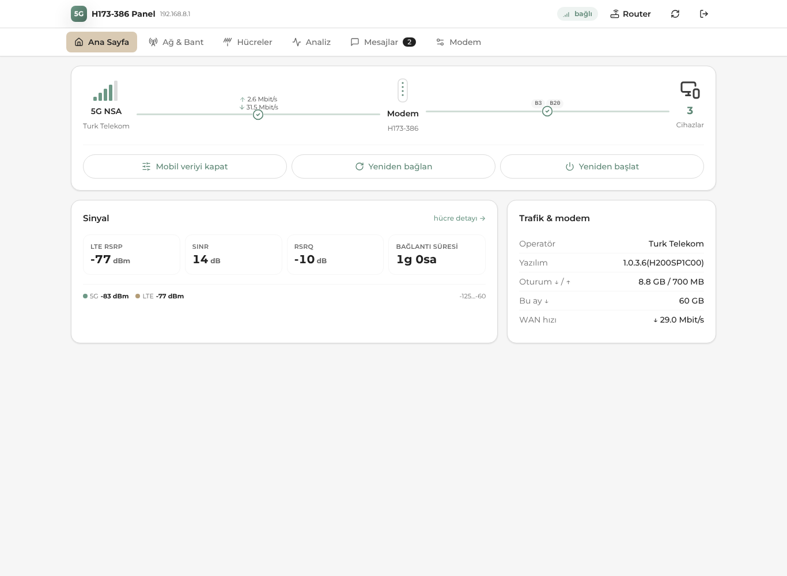
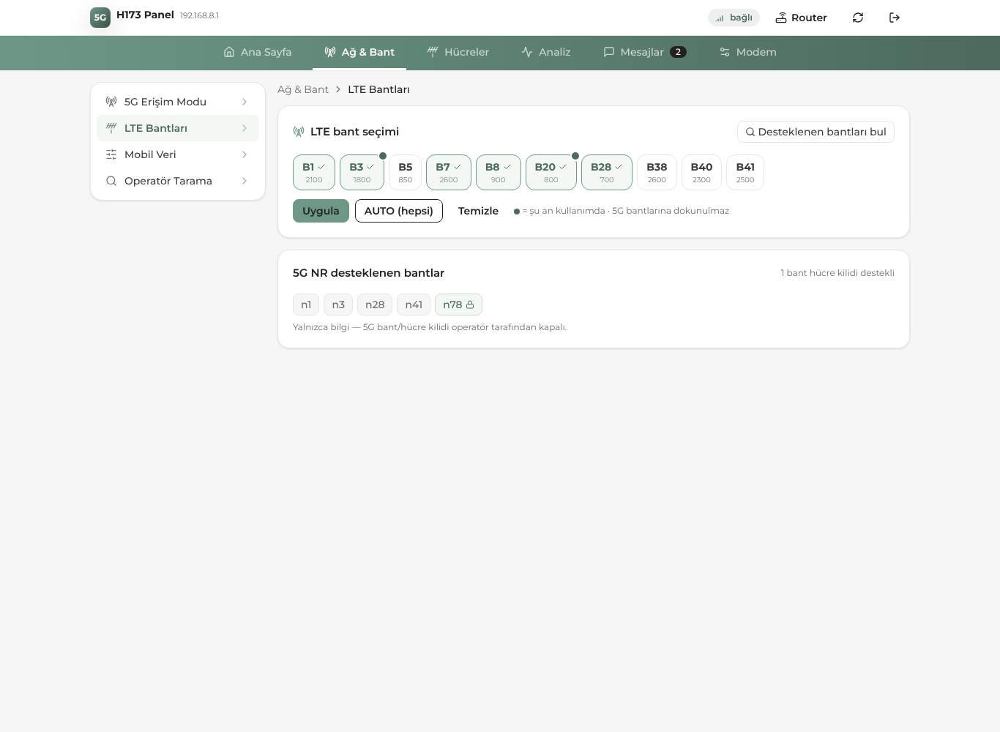
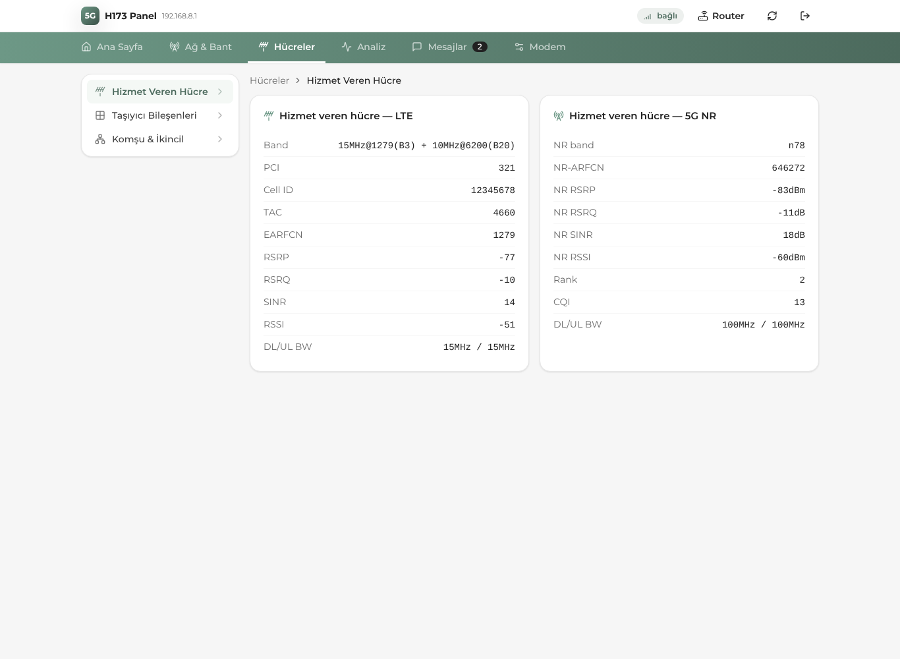
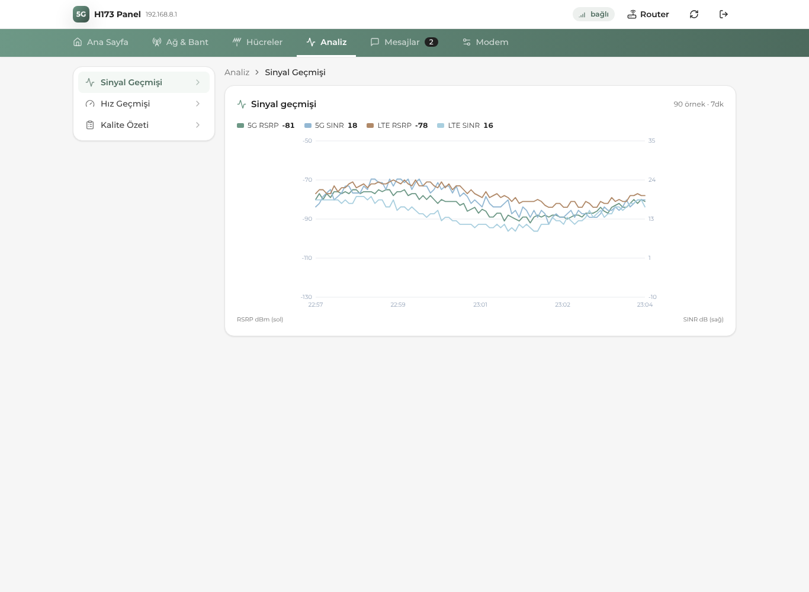
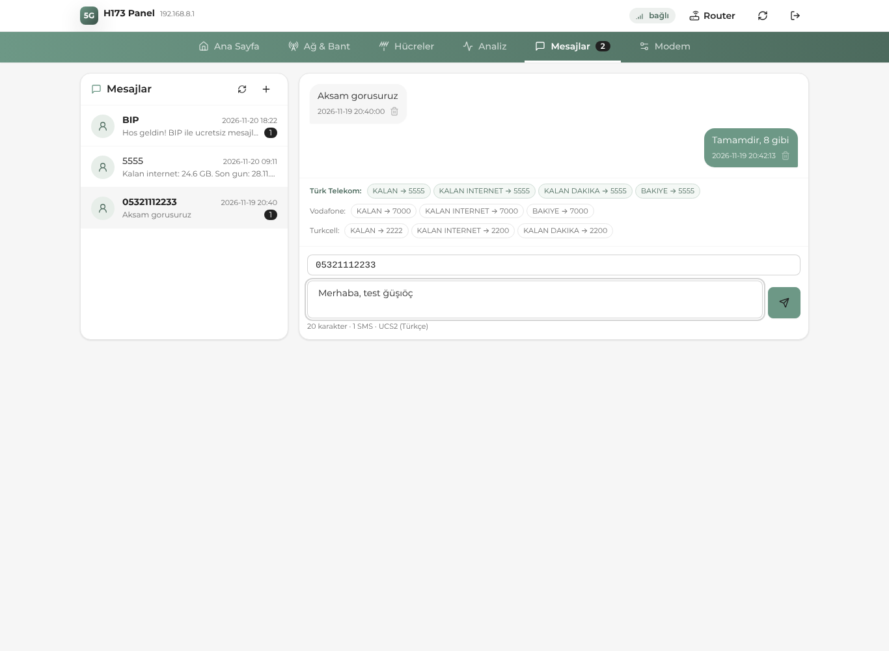
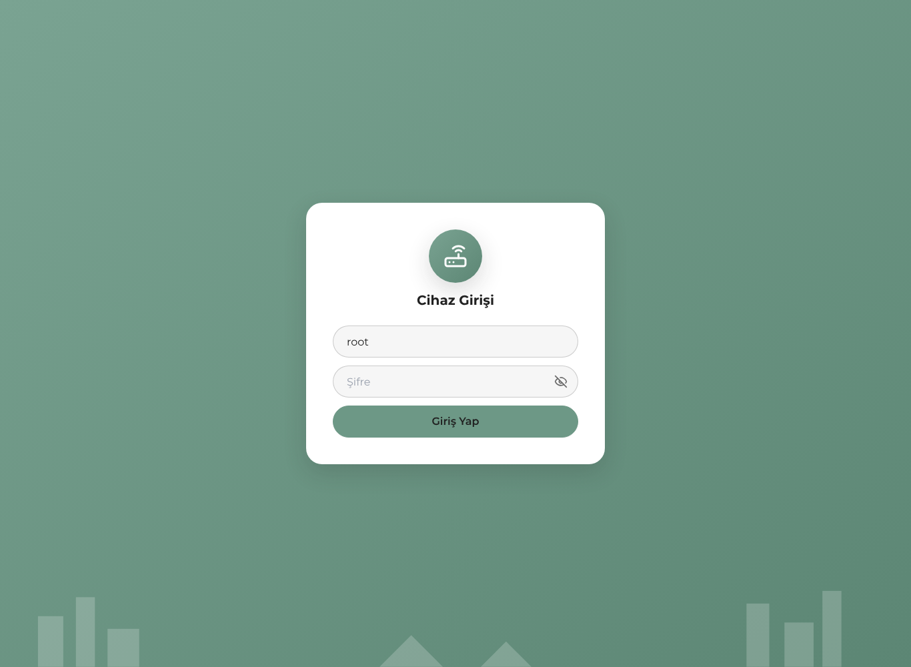

# h173dash

Brovi/Zowee **H173-386 5G CPE** için OpenWrt üzerinde çalışan tek ekran yönetim
paneli. Imou HX21 gibi bir OpenWrt router'ın arkasında **köprü (bridge) modundaki**
H173-386 modemi tarayıcıdan yönetmenizi sağlar: 5G/LTE sinyal ve geçmiş grafikleri,
bantlar, hücreler, trafik, operatör bilgisi, SMS; mobil veriyi aç/kapat, yeniden
bağlan, LTE bant seçimi ve 5G modunu (NSA/SA) yaz.

- **Panel:** `http://<router-ip>/` adresinde (otomatik `/dash/`'e yönlendirir).
- **Giriş:** router'ın **kendi root parolası** (LuCI girişi ile aynı — rpcd oturumu).
- **Modem parolası:** ayrıca `/etc/config/h173` içinde tutulur (daemon modeme bununla bağlanır).
- LuCI arayüzünü **değiştirmez**, yanında çalışır.
- Renk paleti **luci-theme-hx21** ile aynıdır (adaçayı/bej/ink + Montserrat + Lucide).

## Ekran görüntüleri








---

## İçindekiler
1. [Nasıl çalışır?](#nasıl-çalışır)
2. [Gereksinimler](#gereksinimler)
3. [Kurulum](#kurulum)
4. [İlk ayar](#ilk-ayar)
5. [Yapılandırma seçenekleri](#yapılandırma-seçenekleri)
6. [Güncelleme](#güncelleme)
7. [Kaldırma](#kaldırma)
8. [Sorun giderme](#sorun-giderme)
9. [Lisans](#lisans)

---

## Nasıl çalışır?

Üç parçadan oluşur:

| Parça | Nerede | Görevi |
|------|--------|--------|
| **`h173d` daemon** | `/usr/sbin/h173d` (ucode) | Modemi periyodik yoklar, verisini **`h173`** adlı bir **ubus** nesnesi olarak yayımlar. |
| **Vue panel** | `/www/dash/` (statik) | Tarayıcıda çalışır; `/ubus` köprüsü üzerinden daemon'a JSON-RPC ile konuşur. |
| **rpcd ACL** | `/usr/share/rpcd/acl.d/h173-*.json` | Oturumun `h173` nesnesine (ve panelin kullandığı router ubus'larına) erişmesine izin verir. |

Akış: Tarayıcı → `uhttpd`'nin `/ubus` köprüsü → `rpcd` (yetki + `session.login`) →
`h173d` daemon → modem. Bu yüzden kurulumda `uhttpd.main.ubus_prefix=/ubus`
ayarlanır ve `rpcd` yeniden başlatılır; bunlar olmazsa panel "oturum geçersiz" ya da
"metod yok" hataları verir.

---

## Gereksinimler

- **OpenWrt 24.10+ / 25.x** (apk paket yöneticisi) ya da apk destekli bir yapı.
  Eski (`opkg`) sürümlerde de `.ipk` ile çalışır.
- Router'da bir **root parolası tanımlı** olmalı (panel girişi bununla yapılır).
  Yoksa: `passwd` ile belirleyin.
- İnternet erişimi (betik bağımlılıkları indirir).
- Modem **köprü modunda** router'ın arkasında olmalı ve router'dan modemin web
  arayüzüne (örn. `192.168.8.1`) erişilebilmeli.
- Betiğin kurduğu bağımlılıklar (çoğu LuCI'li sistemde zaten vardır):
  `rpcd uhttpd uhttpd-mod-ubus rpcd-mod-file rpcd-mod-iwinfo rpcd-mod-luci`
  ve daemon için `ucode ucode-mod-digest/fs/uloop/ubus/uci/socket`.
  Bunlardan en sık eksik olan **`ucode-mod-socket`**'tir.

---

## Kurulum

İki yol var. Çoğu kullanıcı için **A yolu** yeterlidir.

### A) GitHub'dan, derlemesiz (önerilen)

Router'a SSH ile bağlanın ve (kendi GitHub kullanıcı adınızla) tek satırı çalıştırın:

```sh
wget -qO- https://raw.githubusercontent.com/ulas/h173dash/main/install.sh \
  | REPO=ulas/h173dash sh
```

Betik sırayla şunları yapar — her adımı açıkça:

1. **Bağımlılıkları kurar** (`apk add ...`; zaten kuruluysa atlar). Daemon'ın
   çalışması için gereken `ucode-mod-socket` vb. burada gelir.
2. **Repo arşivini indirir** (`main` yoksa `master` dalını dener) ve açar.
3. **Dosyaları yerleştirir:** panel `/www/dash`, daemon `/usr/sbin/h173d`,
   ucode modülleri, init betiği, rpcd ACL'leri. Kök `/www/index.html`'i panele
   yönlendirir.
4. **Yapılandırma:** `/etc/config/h173` **yoksa** varsayılanı oluşturur; **varsa
   dokunmaz** (modem parolanız korunur). İzni `600` yapar (parola gizli kalsın).
5. **ubus + servis:** `uhttpd.main.ubus_prefix=/ubus` ayarlar, daemon'ı
   `enable`+`start` eder, `rpcd` ve `uhttpd`'yi yeniden başlatır.

Bitince panel `http://<router-ip>/` adresinde olur.

> **Önemli:** Bu betik reponuzdan dosya indirir. Repoyu push ederken `files/www/dash/`
> klasörünün (panel dist'i) commit'e **girdiğinden** emin olun. GitHub Desktop'ta
> "Changes" listesinde `files/www/dash/...` görünmeli.

### B) OpenWrt paketi (.apk / .ipk)

Panel **noarch** (`PKGARCH:=all`) olduğundan **herhangi bir** güncel OpenWrt SDK
(apk nesli: 24.10+/snapshot) ile derlenebilir; üretilen `.apk` mimariden bağımsızdır
ve cihazınıza kurulur.

**Lokalde (kendi SDK'nızla):**
```sh
./build.sh /yol/openwrt-sdk        # → dist-pkg/h173dash_*.apk
scp dist-pkg/h173dash_*.apk root@192.168.1.1:/tmp/
ssh root@192.168.1.1 'apk add --allow-untrusted /tmp/h173dash_*.apk'
#   eski sürüm:  opkg install /tmp/h173dash_*.ipk
```
Paket kurulunca bağımlılıklar **otomatik** çözülür ve postinst ubus/daemon ayarını
yapar; ek işlem gerekmez.

**GitHub Actions ile (SDK sizde yoksa):** repoya bir etiket push edin:
```sh
git tag v1.0.0 && git push --tags
```
`.github/workflows/build.yml` SDK'yı indirir, `.apk` derler ve **Release'e** ekler.
SDK URL'sini workflow'un "Run workflow" girişinden değiştirebilirsiniz.

---

## İlk ayar

Kurulumdan sonra modem web parolasını girin (panel bununla modeme bağlanır):

```sh
uci set h173.main.password='MODEM_WEB_SIFRESI'
uci commit h173
/etc/init.d/h173 restart
```

Modem farklı bir IP/kullanıcıdaysa (köprü moduna göre değişir):
```sh
uci set h173.main.host='192.168.8.1'      # modemin web adresi
uci set h173.main.username='vodafone'     # ya da 'admin'
uci commit h173; /etc/init.d/h173 restart
```

---

## Yapılandırma seçenekleri

`/etc/config/h173` (`uci set h173.main.<anahtar>='<değer>'; uci commit h173`):

| Anahtar | Varsayılan | Açıklama |
|--------|-----------|----------|
| `enabled` | `1` | Daemon açık/kapalı. |
| `host` | `192.168.8.1` | Modemin web arayüzü adresi. |
| `username` | `vodafone` | Modem web kullanıcı adı (`admin` da olabilir). |
| `password` | *(boş)* | Modem web parolası. **Zorunlu.** |
| `interval` | `5` | Sinyal/trafik yoklama aralığı (sn). Hücreler 3×, yavaş veri 12×. |
| `history` | `720` | RAM'de tutulan örnek sayısı (720 × 5sn = 1 saat). |
| `show_ids` | `0` | IMEI/IMSI/ICCID'yi tam göster (`1`) ya da maskele (`0`). |
| `transport` | `auto` | `auto` / `socket` / `uclient` (auto = `ucode-mod-socket` varsa socket). |
| `sms_mode` | `auto` | `auto` / `ecc` (web arayüzü, şifreli) / `classic` (AI Life, düz). |

> Parola gizli kalsın diye `/etc/config/h173` izni `600`'dür; `uci` komutları yine çalışır.

---

## Güncelleme

- **A yoluyla kurduysanız:** aynı `install.sh` tek satırını tekrar çalıştırın.
  Yeni dosyalar üzerine yazılır, **`/etc/config/h173` (parolanız) korunur.**
- **Paketle kurduysanız:** yeni `.apk`'yı `apk add --allow-untrusted ...` ile kurun.

---

## Kaldırma

### Paket olarak kurduysanız
```sh
apk del h173dash          # (veya: opkg remove h173dash)
```

### Betikle (elle kurulanlar dahil — her durumda çalışır)
Daemon'ı durdurur ve disable eder, tüm panel/daemon/ucode/ACL dosyalarını siler,
**kök URL'yi LuCI'ye geri döndürür** (`/www/index.html`), LuCI önbelleğini temizler,
`rpcd`+`uhttpd`'yi yeniler:
```sh
wget -qO- https://raw.githubusercontent.com/ulas/h173dash/main/uninstall.sh | sh
```
Varsayılan olarak **`/etc/config/h173` (modem parolası) korunur** — yeniden kurulumda
tekrar girmeyin diye. Her şeyi (parola + `ubus_prefix`) silmek için:
```sh
wget -qO- https://raw.githubusercontent.com/ulas/h173dash/main/uninstall.sh | sh -s -- --purge
```

> `ubus_prefix=/ubus` ayarını normal kaldırmada **bırakırız**, çünkü LuCI de `/ubus`
> köprüsünü kullanır; sadece `--purge` bunu geri alır.

### Tamamen elle
```sh
/etc/init.d/h173 stop; /etc/init.d/h173 disable
rm -rf /www/dash /usr/sbin/h173d /usr/libexec/h173-ecdh /usr/share/ucode/h173 \
       /usr/share/rpcd/acl.d/h173-*.json /etc/init.d/h173 /etc/config/h173
/etc/init.d/rpcd restart; /etc/init.d/uhttpd restart
```
Kaldırmadan sonra tarayıcıyı **Ctrl+Shift+R** ile yenileyin.

---

## Sorun giderme

**Panel açılmıyor / boş sayfa**
- `http://<router-ip>/dash/` adresini doğrudan deneyin.
- Tarayıcıyı **Ctrl+Shift+R** ile sert yenileyin (eski JS önbellekte kalmış olabilir).

**Giriş olmuyor**
- Giriş router'ın **root parolasıdır**, modem parolası değil. Root parolası tanımlı mı? (`passwd`)

**"oturum geçersiz" (ubus)**
- `uhttpd.main.ubus_prefix` `/ubus` mi?  `uci get uhttpd.main.ubus_prefix`
- Değilse: `uci set uhttpd.main.ubus_prefix='/ubus'; uci commit uhttpd; /etc/init.d/uhttpd restart`
- `rpcd`'yi yenileyin: `/etc/init.d/rpcd restart`

**"geçersiz argüman" (ör. `h173.status: geçersiz argüman`)**
- `h173d` sürüm **0.5.9 ve üstünde** çözüldü. Daha eskiyse daemon'ı güncelleyin.
- Nedeni: `uhttpd-mod-ubus` her oturumlu `/ubus` çağrısına `ubus_rpc_session` alanını
  ekler; ucode ile yayınlanan nesneler politikada olmayan argümanı reddeder, bu yüzden
  panelden gelen çağrılar düşerken `ubus call h173 status` (oturum eklemez) çalışır.
  0.5.9 her metodun arg politikasına `ubus_rpc_session`'ı ekler.
- Sürümü kontrol: `ubus call h173 status | grep version` ya da `h173d` başındaki `VERSION`.

**"metod yok" / "bulunamadı (h173d çalışıyor mu?)"**
- Daemon çalışıyor mu?  `/etc/init.d/h173 status` ve `ubus list | grep h173`
  (`h173` görünmeli).
- Günlükler: `logread -e h173`
- `ucode-mod-socket` kurulu mu?  `apk info ucode-mod-socket` (yoksa `apk add ucode-mod-socket`)

**Modem verisi gelmiyor / sinyal boş**
- `ubus call h173 status` içinde `session.logged_in` **false** ve `last_error` **"timeout"** ise:
  modem web sunucusu `Connection: close`'u yok sayıp bağlantıyı açık tutuyor olabilir
  (keep-alive). **h173d 0.6.0** bunu Content-Length/chunked sonuyla erkenden tamamlayarak
  çözer — daha eskiyse daemon'ı güncelleyin. `ping 192.168.8.1` ve tarayıcıdan erişim
  çalışıyor ama daemon "timeout" diyorsa belirti tam budur.
- Modem parolası doğru mu?  `uci get h173.main.password`
- Router modemin web adresine erişiyor mu?  `ping 192.168.8.1`
- Kullanıcı adı (`vodafone`/`admin`) ve `host` doğru mu?
- `logread -e h173` modem giriş hatası gösterebilir.

**Daemon sürekli yeniden başlıyor**
- `logread -e h173` ile hatayı görün; genelde eksik `ucode-mod-*` ya da yanlış
  modem adresi/parolasıdır.

---

## Lisans

MIT — `LICENSE` dosyasına bakın.
